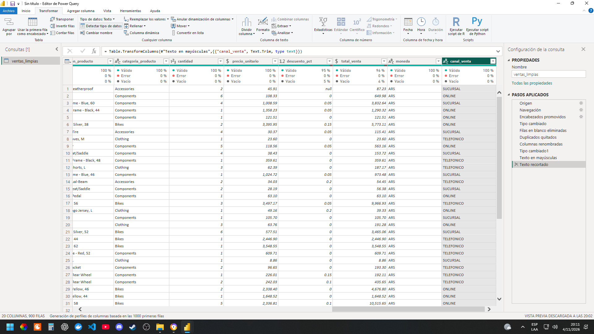
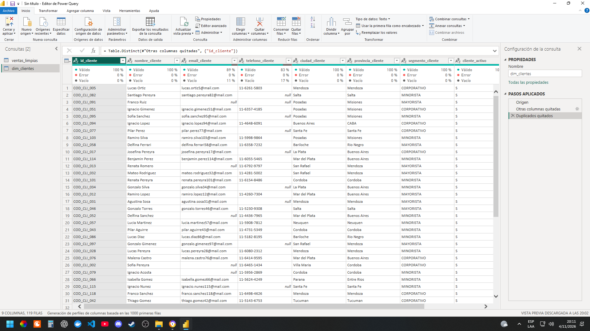
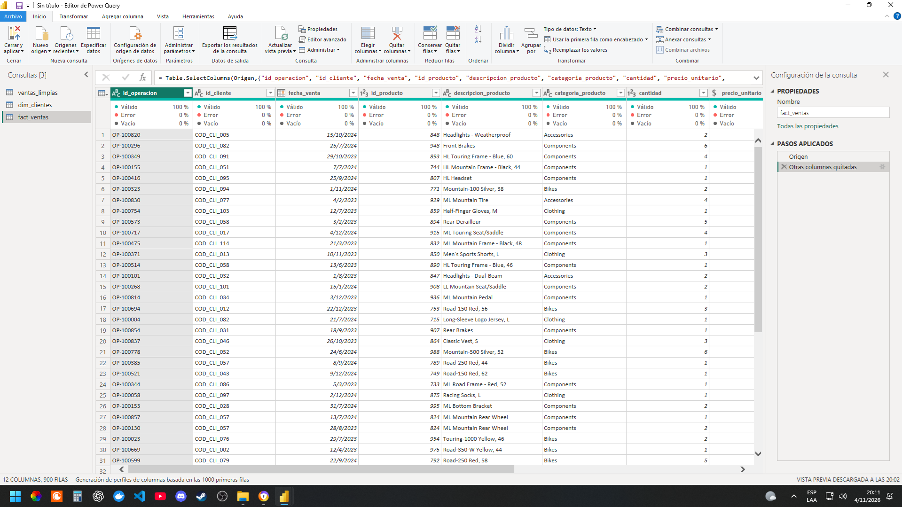
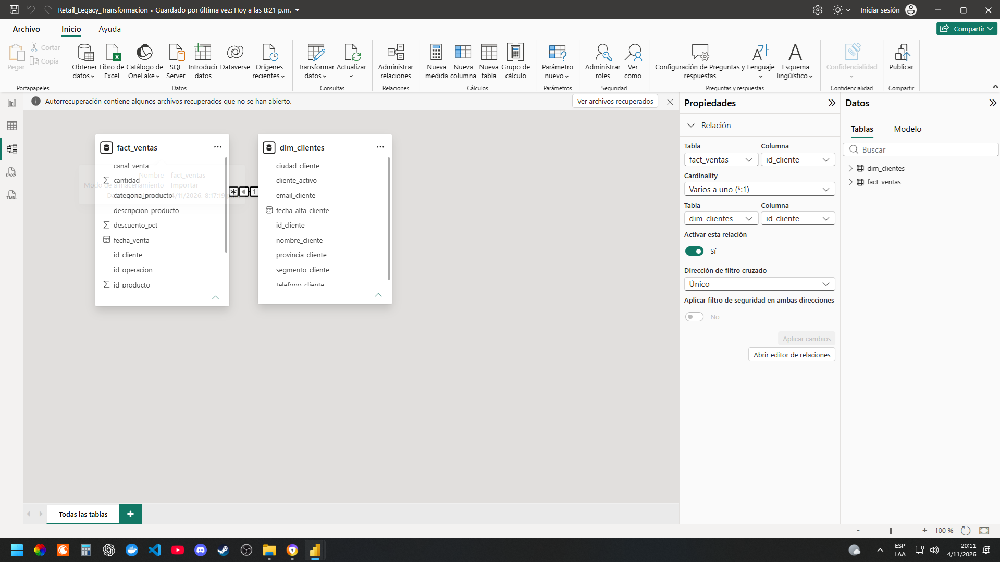

# Power BI | Limpieza y transformación de ventas legacy

**Autor:** Augusto Campeggi  
**Herramienta:** Power BI Desktop — Power Query  
**Fuente:** `Ventas_export_legacy.xlsx` (hoja `VENTAS_EXPORT`)

## Objetivo

Preparar el archivo exportado de un sistema legacy para análisis, mediante extracción desde Excel, limpieza, tipificación, normalización de nombres y separación de información de clientes y operaciones.

## 1. Extracción y orden de transformaciones

Importé el libro mediante **Obtener datos > Excel > Transformar datos**. En la consulta base `ventas_limpias` apliqué, en este orden:

1. **Origen y Navegación:** conexión al archivo Excel y selección de la hoja `VENTAS_EXPORT`.
2. **Encabezados promovidos:** primera fila como nombres de columnas.
3. **Tipo cambiado:** asignación inicial de tipos a los 20 campos.
4. **Filas en blanco eliminadas:** descarte de registros completamente vacíos.
5. **Duplicados quitados:** eliminación de filas exactamente repetidas, sin confundirlas con compras distintas de un mismo cliente.
6. **Columnas renombradas:** conversión de códigos técnicos a nombres descriptivos en `snake_case`.
7. **Tipo cambiado1:** ajuste de tipos, incluida la conversión de `fecha_venta` a fecha.
8. **Texto en mayúsculas:** estandarización de `canal_venta`.
9. **Texto recortado:** eliminación de espacios sobrantes en `canal_venta`.

La consulta base terminó con **900 filas y 20 columnas**. Los nombres descriptivos incluyen `COD_OP` → `id_operacion`, `COD_CLI` → `id_cliente`, `F_VTA` → `fecha_venta`, `PU_VTA` → `precio_unitario` y `TOT_VTA` → `total_venta`.

## 2. Justificación de los tipos de datos

| Campos | Tipo | Motivo |
| --- | --- | --- |
| `id_operacion`, `id_cliente` | Texto | Son códigos identificadores (por ejemplo, `OP-100820`), no valores para sumar. |
| `id_producto`, `cantidad` | Número entero | Identificadores numéricos y unidades indivisibles. |
| `fecha_venta`, `fecha_alta_cliente` | Fecha | Permiten filtrar por períodos y construir análisis temporales sin conservar horas innecesarias. |
| `precio_unitario`, `total_venta` | Decimal fijo / moneda | Conservan precisión apropiada para importes. |
| `descuento_pct` | Decimal | Permite representar proporciones como `0.05` y calcular descuentos. |
| Nombres, teléfonos, categorías, canales y otros atributos descriptivos | Texto | No requieren operaciones aritméticas; los teléfonos pueden contener guiones o ceros iniciales. |

En la evidencia de Power Query se observa la columna `fecha_venta` como fecha, y los campos monetarios con formato numérico. La moneda `moneda` se conserva como atributo para evitar sumar indiscriminadamente importes de monedas diferentes.

## 3. Nulos, duplicados y control de calidad

- **Filas completamente vacías:** se eliminaron en la consulta base.
- **Duplicados exactos:** se quitaron antes de crear las tablas finales. La tabla base quedó en 900 registros.
- **Clientes repetidos por transacciones:** en `dim_clientes` se quitó la duplicación por `id_cliente`, obteniendo 119 registros únicos. Esto es distinto de borrar ventas: un mismo cliente puede comprar varias veces.
- **Datos de contacto incompletos:** se conservaron los `null` de correo electrónico y teléfono porque no deben inventarse datos personales. En la vista de calidad de `dim_clientes` se observan aproximadamente 11 % de correos y 17 % de teléfonos vacíos.
- **Montos faltantes:** se conservaron los `null` de `total_venta` para no falsear ingresos convirtiéndolos en cero. La vista de calidad muestra aproximadamente 4 % de valores vacíos. Deben identificarse y excluirse explícitamente de cálculos que requieran importes válidos, o enviarse a revisión de origen.
- **Descuentos faltantes:** la vista de calidad muestra aproximadamente 5 % de valores vacíos en `descuento_pct`; no se presume automáticamente que equivalen a cero.
- **Errores:** las capturas de calidad de columna muestran 0 % de errores en las columnas visibles. Esto no sustituye una validación integral posterior.

## 4. Separación de datos de clientes y ventas

Para evitar repetir los atributos de un mismo cliente en cada transacción, creé dos consultas **por referencia** a `ventas_limpias`:

### `dim_clientes`

Contiene 9 columnas: `id_cliente`, `nombre_cliente`, `email_cliente`, `telefono_cliente`, `ciudad_cliente`, `provincia_cliente`, `segmento_cliente`, `cliente_activo` y `fecha_alta_cliente`. Seleccioné estas columnas y eliminé las demás; luego quité duplicados por `id_cliente`. **Resultado: 119 filas.**

### `fact_ventas`

Contiene 12 columnas: `id_operacion`, `id_cliente`, `fecha_venta`, `id_producto`, `descripcion_producto`, `categoria_producto`, `cantidad`, `precio_unitario`, `descuento_pct`, `total_venta`, `moneda` y `canal_venta`. Conservé todas las operaciones depuradas: **900 filas**. No quité duplicados por `id_cliente`, porque un cliente puede realizar múltiples compras.

## 5. Relación del modelo

Relacioné `fact_ventas[id_cliente]` con `dim_clientes[id_cliente]` usando cardinalidad **varios a uno (`*:1`)**, relación **activa** y filtro cruzado **único** desde clientes hacia ventas. Esto permite analizar operaciones por atributos de cliente sin duplicar los registros de la dimensión.

## 6. Archivos y reproducción

- `README.md`: documentación y evidencias de los pasos aplicados.
- `capturas/`: cuatro capturas originales de Power Query y de la vista Modelo.
- `Retail_Legacy_Transformacion.pbix`: archivo de Power BI Desktop, incluido como complemento opcional.

**Nota de reproducibilidad:** el archivo PBIX puede conservar la ruta local original del Excel. Si se abre en otra computadora y se desea actualizar, habrá que modificar el origen en **Transformar datos > Configuración de origen de datos** para apuntar a una copia disponible de `Ventas_export_legacy.xlsx`.

**Alcance de la evidencia:** las capturas documentan las transformaciones y la relación del modelo. No se afirma haber ejecutado pruebas adicionales en otro entorno ni haber corregido los importes faltantes en el sistema de origen.
